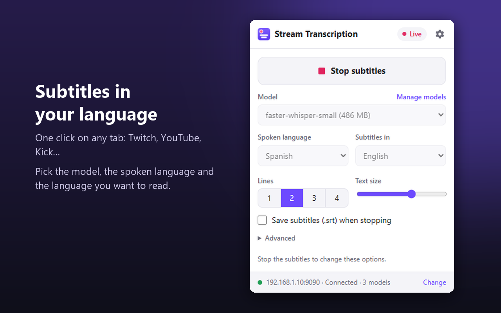
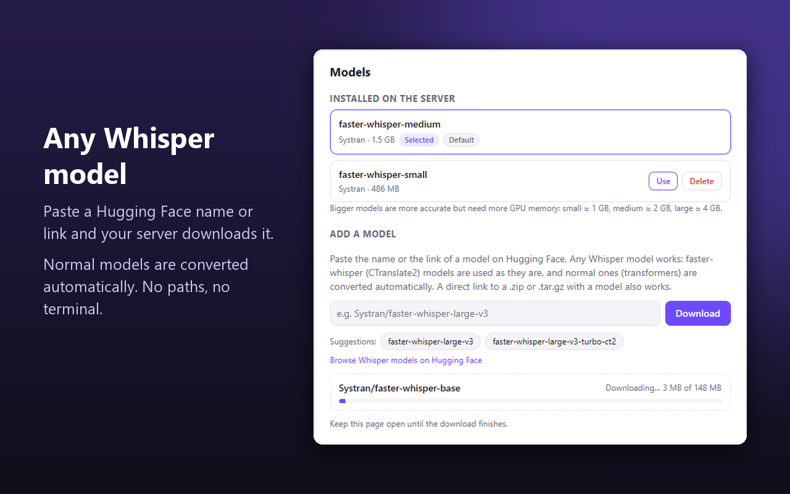

# Stream Transcription

**Live subtitles for any browser tab — transcribed and translated by your own Whisper server.**

Watch a Twitch stream, a YouTube video or a call in a language you don't speak, and read it
in yours, in real time. The audio never leaves your network: it goes only to the
[WhisperLive](https://github.com/collabora/WhisperLive) server you run.

[Versión en español](README.es.md)


## Features

- **Subtitles on top of any page**: Twitch, YouTube, Kick, any `<video>`… They follow you to
  fullscreen, you can drag them anywhere, choose 1–4 lines and the text size.
- **Translation**: Whisper's own translation to English, or any of ~100 languages through the
  server's translator.
- **Any Whisper model, from the extension**: paste a Hugging Face name or link
  (`Systran/faster-whisper-large-v3`, a fine-tuned model for your language, a direct `.zip`…)
  and the server downloads it — converting normal *transformers* checkpoints to
  faster-whisper format automatically. Then pick it from a list. No paths, no terminal.
- **Fits small graphics cards**: an "int8" option halves the model's memory with the same
  text, the translator can run on the CPU, and if the model doesn't fit you get a clear
  **VRAM warning** instead of subtitles that silently freeze.
- **Save the subtitles** as an `.srt` file when you stop.
- English and Spanish interface.
- No accounts, no tracking, no analytics. Open source (MIT).

| Popup | Settings · models |
|---|---|
|  |  |

## Install the extension

- **Firefox** (and Zen, LibreWolf, Floorp…): [addons.mozilla.org](https://addons.mozilla.org/firefox/addon/stream-transcription/)
- **Chromium** (Chrome, Brave, Edge, Opera, Vivaldi…): download
  `stream-transcription-chromium-<version>.zip` from the
  [latest release](https://github.com/javimentallab/stream-transcription/releases/latest),
  unzip it, open `chrome://extensions`, turn on **Developer mode** and click
  **Load unpacked** on the unzipped folder.

Then click the extension's icon, type your server's address (e.g. `192.168.1.10:9090`) and
**Connect**.

## Server

You need a WhisperLive server, ideally on a computer with an NVIDIA graphics card (small
models also run on the CPU). Two options:

### Option A — Stream Transcription server (recommended)

WhisperLive plus the patches that make everything in the extension work (model management,
switching models, int8, translator on the CPU, VRAM warnings). With Docker and the
[NVIDIA Container Toolkit](https://docs.nvidia.com/datacenter/cloud-native/container-toolkit/latest/install-guide.html):

```sh
git clone https://github.com/javimentallab/stream-transcription.git
cd stream-transcription/server
docker compose up -d --build
```

The first start downloads the default model (`Systran/faster-whisper-small`, ~0.5 GB). The
server listens on port **9090** and runs as an unprivileged user; models are kept in the
`models` Docker volume (an old `server/models/` folder is no longer used and can be deleted;
the models are downloaded again). Options in
`docker-compose.yml`:

| Variable | Default | What it does |
|---|---|---|
| `ST_DEFAULT_MODEL` | `Systran/faster-whisper-small` | Model downloaded and used by default |
| `ST_ALLOW_MANAGEMENT` | `1` | `0` = the extension can list models but not download or delete them |
| `ST_MAX_CLIENTS` | `4` | Simultaneous transcriptions |
| `HF_TOKEN` | — | For gated or private Hugging Face models |

Anyone who can reach the port can use the server (and, with management on, download or
delete models): keep it inside your network or behind a firewall.

### Option B — plain WhisperLive

The extension also works with an unmodified WhisperLive server. You then type a model size
(`tiny`, `small`, `medium`, `large-v3`…) instead of choosing from a list, and the
model-management and performance options are not available.

## How much graphics memory?

| Model | VRAM (float16) | With "Save memory (int8)" |
|---|---|---|
| small | ~1 GB | ~0.6 GB |
| medium | ~2 GB | ~1.2 GB |
| large-v3 / turbo | ~4 GB | ~2.3 GB |

The translator adds ~0.7 GB on the GPU (or nothing, set to run on the CPU).

## Privacy

The extension sends the tab's audio **only** to the server address you enter, and nothing
else anywhere. It stores its settings in your browser. See [PRIVACY.md](PRIVACY.md).

## Building

```sh
python tools/build.py
```

Creates `dist/chromium`, `dist/firefox` and their zips from `extension/shared` plus each
browser's folder. Texts for both languages live side by side in `tools/i18n-messages.py`.

## Credits and license

MIT ([LICENSE](LICENSE)). Built on [WhisperLive](https://github.com/collabora/WhisperLive) by Collabora (MIT, see
[NOTICE](NOTICE)) and
[faster-whisper](https://github.com/SYSTRAN/faster-whisper). Translation uses
[SMALL100](https://huggingface.co/alirezamsh/small100).
